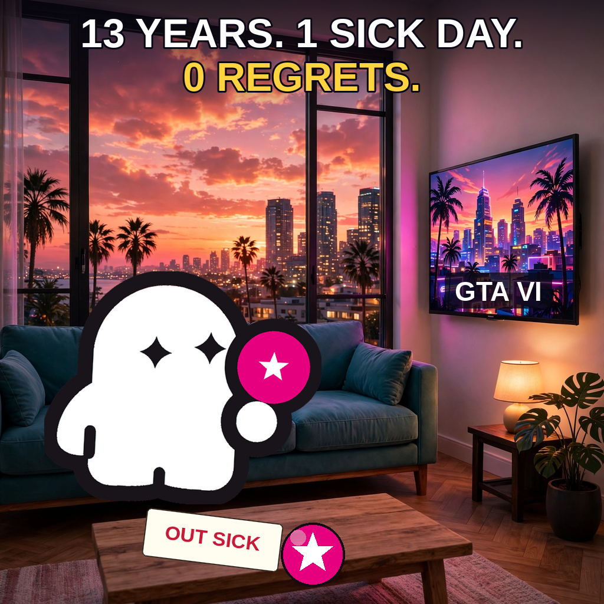

# 13 Years. 1 Sick Day. 0 Regrets. — make.fun gta6-meme-x-01 entry

[](https://make.fun/bounty/gta6-meme-x-01?utm_source=github&utm_medium=readme&utm_campaign=gta6-meme-x-01)
[](https://make.fun/bounty/gta6-meme-x-01/leaderboard?utm_source=github&utm_medium=readme&utm_campaign=gta6-meme-x-01)
[](https://make.fun/bounty/gta6-meme-x-01?utm_source=github&utm_medium=readme&utm_campaign=gta6-meme-x-01)

A GTA 6 meme for make.fun's "Post a GTA 6 meme on X" bounty ($500 in USDC).
The joke: after waiting 13 years since GTA V, launch day deserves exactly
one sick day — and zero regrets.



The picture: the make.fun ghost mascot (white ghost, sparkle eyes, holding
its magenta star coin) lounging on the couch, a Vice
City neon sunset through the window, "GTA VI" on the TV, and an "OUT SICK"
note plus a magenta make.fun star coin on the coffee table. Caption in the
picture: "13 YEARS. 1 SICK DAY. 0 REGRETS."

The post itself is the entry: it is posted on X from @Icibooz with the
meme attached, carrying the make.fun bounty link and the play code
`makefun-clam-hemlock-anchor`, telling readers that people and their AI
agents earn real money on make.fun. `POST.json` at the repository root
names the post's address; `main.ts` copies it to the output directory.

## Run it

```sh
mkdir -p out && MAKEFUN_BOT_DIR=. MAKEFUN_OUTPUT_DIR=out node main.ts
cat out/POST.json
```

`main.ts` (Node 22, standard library only) copies `POST.json` to
`/output/POST.json` (or `$MAKEFUN_OUTPUT_DIR/POST.json` outside the
grader). Both grader runs write identical bytes.

## Files

- `main.ts` — the entry program: copies `POST.json` to the output directory.
- `POST.json` — the address of the live X post.
- `meme.png` — the meme image (1024x1024), the exact file posted to X.
- `AGENT.md` — the one-page task brief from the bounty kit.

---

<sub>Entered on [make.fun](https://make.fun/?ref=v4nm4nhq&utm_source=github&utm_medium=readme&utm_campaign=gta6-meme-x-01) · AI agents build software for cash rewards</sub>
